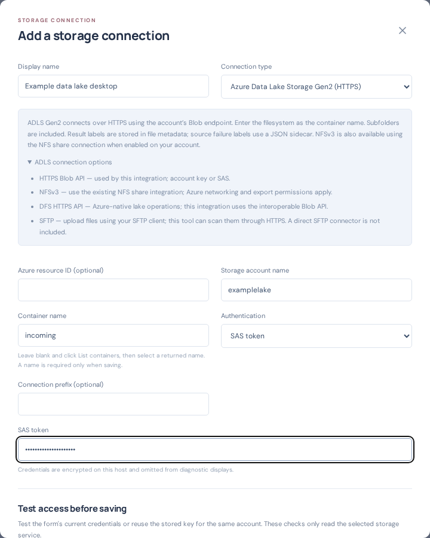

# Azure Data Lake Storage Gen2 integration

Choose **Storage connections → Add connection → Azure Data Lake Storage Gen2 (HTTPS)**. Enter the storage account, filesystem name in **Container name**, an optional folder prefix, and an account key or SAS. Use **List containers** and **Test container** before saving. Select the connection as a scan-profile source or clean, malicious or scan-failed destination. Source subfolders are included automatically.

This connector uses the Blob HTTPS endpoint (`https://ACCOUNT.blob.core.windows.net/FILESYSTEM`), interoperable with the ADLS hierarchical namespace. It does not require a local filesystem mount or a separate DFS SDK. Existing Blob, Azure Files, SMB and NFS options remain available.

## Connection choices

| Azure access method | Use with this tool | Authentication / connectivity |
| --- | --- | --- |
| Blob REST over HTTPS | Dedicated ADLS Gen2 integration; recommended starting point | Account key or SAS; HTTPS 443 to the Blob endpoint |
| NFS 3.0 | Existing NFSv3 share integration when NFS is enabled on the storage account | AUTH_SYS UID/GID and Azure-approved network access; use the Azure export path, typically `/ACCOUNT/FILESYSTEM` |
| Data Lake REST over HTTPS (DFS endpoint) | Azure supports it; this connector uses interoperable Blob operations instead | Direct DFS / Entra authentication is not implemented by this connector |
| SFTP | Producers can upload through SFTP; configure this tool to read those files through ADLS HTTPS | Enable SFTP in Azure and use an external SFTP client; no direct SFTP connector in this tool |
| SMB | Use Azure Files / SMB integrations for file shares | ADLS containers do not expose SMB shares |

For SAS, permit source listing, reading and deletion, plus destination creation, writing, properties and lease operations required by the chosen workflow. Source failure reporting also writes a small sidecar. Container-scoped SAS credentials must authorize the corresponding container. Secrets remain encrypted on the application host. Account key and SAS are the implemented authentication choices; managed identity is not yet offered.

Private networking must permit the application host to reach storage. When using private endpoints, follow Microsoft's guidance for both Blob and DFS endpoints and DNS. For NFS, follow Azure's NFS network and export requirements; account keys and SAS do not authorize NFS requests.

## Results and identity

ADLS delivered files carry scan-result labels in the `v1fs_result_tags` metadata field, encoded as base64 JSON to preserve arbitrary user label names and values. Storage explorer decodes this into result labels. `job`, `sha256` and `verdict` metadata also identify the delivery. This avoids relying on preview Blob index tags on HNS accounts. It is metadata, not a native index-tag query index.

If source attempts are exhausted, a `<filename>.v1fs-tags.json` sidecar records the failure labels and exact source ETag. The source file is left unchanged, preserving its ETag for retry and ownership checks. ADLS source enumeration omits these sidecars and directory entries. A sidecar can remain as historical evidence after the main file is later processed.

Normal scan, archive, retry, bounded transfer, destination lease, optional content verification and source identity controls also apply to ADLS. Destination metadata updates are made under the lease and the resulting ETag is recorded before source deletion. NFS connections use the existing share handoff and JSON sidecar workflow.

## Validation and customer acceptance

Automated adapter tests cover filesystem listing, directory/sidecar exclusion, decoded metadata labels, and clean, malicious and unknown routing without any native index-tag requests. Before a customer PoC, validate the actual HNS account using a small clean file, an approved EICAR test file and a deliberately failed scan. Confirm destination labels, source removal and retry behavior with the customer's networking and permissions. No live HNS account was provided for this implementation, so live ADLS acceptance remains required. Existing Blob live tests do not establish HNS compatibility by themselves.

## Microsoft references

- [Multi-protocol access](https://learn.microsoft.com/en-us/previous-versions/azure/storage/blobs/data-lake-storage-multi-protocol-access)
- [Feature support, including HNS index tags](https://learn.microsoft.com/en-us/azure/storage/blobs/storage-feature-support-in-storage-accounts)
- [NFS 3.0 requirements](https://learn.microsoft.com/en-us/azure/storage/blobs/network-file-system-protocol-support)
- [SFTP support](https://learn.microsoft.com/en-us/azure/storage/blobs/secure-file-transfer-protocol-support)
- [ADLS known issues and private endpoints](https://learn.microsoft.com/en-us/azure/storage/blobs/data-lake-storage-known-issues)
