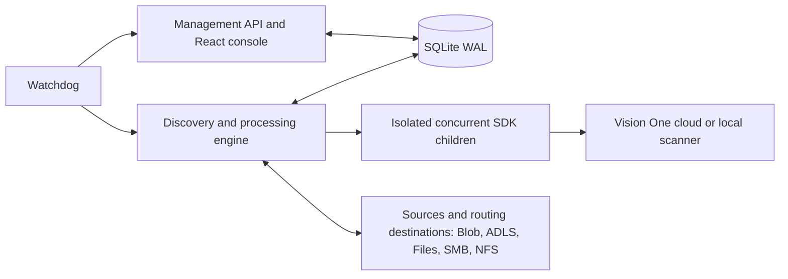

# Architecture

See [customer PoC architecture](poc-architecture.md) for downloadable diagrams, all components and a demonstration checklist.

A supervised container runs independent management and processing services. The React console is served by the management API. Discovery, the durable queue and file routing run in a separate engine process. Each SDK request runs in a short-lived child process so cloud/local endpoint environment settings cannot mix between concurrent scans.

## Process ownership and responsiveness

The supervisor initializes the database/key before launching either service, and watches each independently. API recovery does not reset in-flight jobs or restart the engine. Engine recovery requeues interrupted SCANNING/ROUTING jobs and resumes persisted transfer/handoff evidence. SDK children are terminated if their parent dies; jobs remain durable. Separate advisory locks prevent duplicate API/engine owners.

The API has a four-connection SQLite pool, with per-connection busy timeout and foreign-key settings. The engine serializes its database writes through one connection. WAL permits API reads while the engine writes. Indexed history pagination and indexed newer-version lookups avoid holding database access during repeated unindexed history scans. Browser auto-refresh requests do not overlap.

Each profile's **Schedule → Files scanned at once** setting defaults to 2 and accepts 1–32. The engine resizes its worker pool automatically from the sum of saved profile limits, including profiles used for manual scans. A profile set to 20 can admit 20 scan-stage jobs; another profile has its own independent budget. There is no hidden eight-worker ceiling, and the legacy `V1FS_MAX_WORKERS` variable is ignored. Overview shows **Configured scan capacity**, the total from saved profiles. Admission checks live per-profile limits against SCANNING jobs. Raising a limit grows worker capacity within about one second. Lowering it stops additional admissions until active jobs fall below the new limit; active scans are never cancelled. Retiring workers finish their current job. Scan slots cover download and scanning; transfers use a separate bounded pool. Disk, large-file and archive controls still apply.

## State and security

SQLite stores encrypted configuration and immutable job snapshots (AES-256-GCM), durable jobs, stage attempts, transfer/claim evidence, scan details, observations and audit history. The host master key and database must be backed up together. Administrator passwords use bcrypt; browser sessions use HttpOnly cookies. Credentials pass to SDK children through private standard input, never command-line arguments. Results return through a dedicated pipe, separate from SDK logging. The public engine heartbeat contains health/progress only.

## Discovery and version ownership

Connections support Azure Blob, Azure Files, SMB2/3 signing and NFSv3 TCP AUTH_SYS. They are application connections, not privileged OS mounts. Each profile monitors one source and routes to distinct, non-overlapping clean, malicious and scan-failed destinations. Intervals are 5–86400 seconds, default 30; 10 seconds is recommended. Files must remain unchanged across observations for the configured quiet period. Stability cannot prove a producer will never resume writing.

An active source version has one job per profile even if that profile is edited while work is queued. Existing jobs retain their original encrypted policy. Newly observed source versions use the current revision. Connection root identity is checked when reusing an active job. Source-only reconciliation accounts for observed file versions; files removed before polling cannot be guaranteed.

Share sources use persisted private claims under `.v1fs-claims/<job-id>/...`; producers must not write there. Claim recovery preserves a new upload at the original path. Blob source deletion is conditional on the captured ETag. Destination share finalization requires scanner-managed writers; Blob destinations use renewable leases during verification/deletion.

## Verdicts, routing and recovery

The official Vision One SDK handles cloud or local scanning. Compact and verbose ATSE/TrendX results are normalized. Error-bearing, incomplete or unsupported results remain UNKNOWN; detections never become clean because another engine failed.

Routing preserves original bytes, publishes without overwriting another file, by default reads back the destination and verifies size, SHA-256 and CRC32C before removing the unchanged source. Profiles can disable destination content readback while retaining upload, size, identity and ownership checks. Names are `original-name_<job-id>.ext`. The app adds no ZIP wrapping/password. Native Blob tags, ADLS metadata or share JSON sidecars record configured result labels. See [ADLS Gen2 integration](adls-gen2.md) for protocol and metadata details.

Scan, transfer and deletion have separate bounded retry budgets. A verified scan is reused after transfer failure. UNKNOWN files route to scan-failed storage for review. Delivered files are owned by the downstream application; no automatic destination recovery, historical content readback or rescanning occurs after handoff. Exclusions are explicitly EXCLUDED / NOT SCANNED and still require transfer verification. Hold rules take priority and leave files at source.

## Dashboard and health

Pending scans counts QUEUED/RETRY_PENDING jobs awaiting scanning with UNKNOWN verdict, including retry delays; it excludes held work and transfers with a known verdict. Scanning now counts SCANNING jobs. Routing is separate. Historical rolling totals count distinct jobs with scanner responses. All these counts query the full database, not the displayed activity page.

`/livez` reports management/database liveness and includes independently reported engine status. The engine publishes progress every second; stale or unhealthy engine health triggers its own watchdog restart. Container `-healthcheck` requires both services. Storage/scanner outages use processing retries rather than liveness restart loops. Overview exposes engine state and worker capacity so operators can inspect a recovering engine while the console remains available.

CSV covers full history; the UI provides filtered pagination. Detection details are encrypted separately, with recorded malware names/engines exposed in authenticated record details. Credentials and raw snapshots are never exported. External notifications remain deferred.

## Large-file execution

See [large-file controls](poc-architecture.md#large-files-and-policy). Worker heartbeats continue during long attempts, bounded by the job deadline; a worker stuck after its deadline eventually loses its heartbeat and triggers recovery. Child/SDK timeouts follow profile duration. Exact source-version inventory rows link to existing durable jobs to reconcile historical admission errors without changing scan results.

## Optional archive inspection

[Archive inspection](archive-inspection.md) adds a credential-free, Landlock/seccomp-confined extraction subprocess before SDK scans. All layers share entry/byte/ratio/time budgets. Original and extracted members are scanned sequentially; a shared cap of two archive inspections and per-profile limits prevent fan-out. Full encrypted member evidence is retained separately from compact activity summaries. The original archive, never extracted members, follows the existing verified routing path.

## Independent scan and transfer pools

The engine persists encrypted transfer handoffs in `transfer_queue`; scan workers can admit the next source while transfer workers upload, lease, verify, tag and delete. Profile limits apply independently to scans, transfers and large transfers; scan workers follow saved profile budgets, while the separate transfer pool caps delivery concurrency. SHA-256/CRC32C are calculated together during capture and together in one leased Blob readback. `job_timings` records stage durations. `hidden_jobs` changes activity presentation only and cannot suppress accounting or assurance alerts. See [performance tuning](performance-tuning.md) for restart and backpressure details.

```mermaid
flowchart LR
  Source[Recursive source discovery] --> Jobs[(Durable jobs and inventory)]
  Jobs --> Capture[Bounded capture and scan pool]
  Capture --> Optional[Optional archive sandbox and member scans]
  Optional --> SDK[Vision One cloud or local scanner]
  Capture --> Transfers[(Encrypted bounded transfer queue)]
  SDK --> Transfers
  Transfers --> Pool[Separate transfer pool]
  Pool --> Upload[Upload exact original bytes]
  Upload --> Lease[Lease destination and verify SHA-256 plus CRC32C once]
  Lease --> Tags[Apply result tags]
  Tags --> Delete[Conditional source deletion]
  Delete --> History[(History, timings and audit)]
```

## Guided console

The profile editor has six client-side steps: Source, Destinations, Schedule, Protection, Options and Review. Its draft is retained across steps, all fields are validated before save, and technical settings are disclosed on demand. The backend profile schema and processing rules are unchanged by the wizard. Overview scan-issue totals and File activity use one shared SQL predicate so the displayed count and filtered list agree, including hidden history when explicitly opened from a card.
