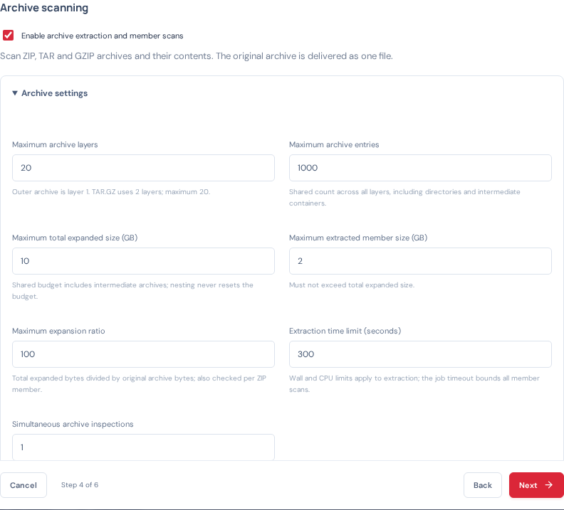

# Compressed-file inspection

## Enable and configure

Open **Scan profiles → Edit profile → Protection → Archive scanning** and select **Enable archive extraction and member scans**. Open **Archive settings** to set its budgets. The option defaults to off for both new and existing profiles. Changes apply to newly queued job snapshots; existing queued/held work retains its original policy. Use a separate test profile or linked recovery with the current policy to validate new settings.

Supported extraction formats are ZIP/ZIP64 (stored/deflate methods), TAR and GZIP, including nested combinations. ZIP-based documents and packages are recognized by signature or supported extension. RAR, 7z, BZIP2, XZ, Zstandard, CAB and ISO are not extracted by this release. Detected unsupported archives fail closed when this option is enabled. With the option off, the original file continues through the normal SDK scan path.

| Setting | Default | Allowed range and purpose |
|---|---|---|
| Maximum archive layers | 5 | 1–20. Outer archive is layer 1; TAR.GZ consumes two layers. At 20 layers a regular leaf is permitted, but another archive at layer 21 is refused. |
| Maximum archive entries | 1,000 | 1–10,000 shared across the full tree. Counts directories and intermediate container members too. |
| Maximum total expanded size | 10 GB | Up to 100 GB decimal. Counts actual extracted bytes, including intermediate nested archives; budgets never reset at a new layer. |
| Maximum extracted member size | 2 GB | At most the total expanded-size budget. Increase for legitimate larger members only after sizing disk and scan time. |
| Maximum expansion ratio | 100 | 1–10,000. Cumulative extracted bytes versus original compressed file size; also checks ZIP member size ratios. |
| Extraction time limit | 300 seconds | 1–3,600. Wall-clock limit and a CPU-time limit; this bounds extraction, while Maximum job duration bounds extraction plus all SDK scans and routing. |
| Simultaneous archive inspections | 1 | 1–2 per profile, within profile/global worker limits. This instance also has a shared cap of two archive inspections. |

Defaults are conservative starting points, not a guarantee that every legitimate archive will fit. Highly compressible legitimate data can exceed a ratio limit; inspect the failure before increasing limits. Enabling 20 layers does not disable the other limits.

## Scan and routing behavior

The extraction helper inventories and hashes supported members in a private workspace. After extraction completes, the app scans the **original archive and every extracted regular member**, including intermediate archive containers, through isolated official SDK clients. Member scans run sequentially inside one inspection; multiple archive jobs may run within the configured caps. This prevents a single archive from creating thousands of simultaneous SDK requests.

Member exclusions and oversized-to-clean bypass rules do not apply inside archive inspection. A member above its extraction limit blocks completion rather than silently bypassing scanning.

- **CLEAN:** extraction completed within policy and all required scans returned clean.
- **MALICIOUS:** at least one required file scan returned malicious. A malicious finding is retained even if another member could not be verified.
- **UNKNOWN:** extraction failed, a limit was exceeded, encryption/unsupported content was encountered, or any required scan remained unknown without a malicious finding.

An engine error on the original archive is not ignored because member scans are clean. In particular, application-side extraction does not override the previously observed VPLE.zip ATSE -82 error. Successful SDK submission and complete engine inspection are distinct.

Policy/extraction blocks go to scan-failed storage for review without repeating the same extraction policy failure through the scanner retry budget. Transient scan failures still use the bounded profile scan-retry behavior. Insufficient workspace capacity waits without spending scan attempts. No incomplete archive becomes clean.

Only the **original, unchanged archive** is routed to the configured destination. Extracted files are never published or executed. Existing SHA-256/CRC32C destination verification and conditional source deletion remain in force.

## Protection against archive bombs and unsafe content

Defense uses independent limits and isolation rather than relying on archive headers alone:

1. Actual extracted bytes consume a shared total-size and expansion budget across every layer, including intermediate archives. Declared ZIP/TAR sizes are checked before extraction, then verified against actual bytes. ZIP integrity/checksum failures prevent completion.
2. Entry count includes directories and nested containers; depth is checked before opening a deeper archive. ZIP central-directory metadata parsing is also bounded by the helper's process limits.
3. Absolute paths, traversal components, backslashes, drive/stream separators, control characters and duplicate paths are rejected. Output uses generated filenames rather than attacker-provided paths.
4. Symbolic/hard links, sparse TAR files, devices, sockets and other special entries are refused. Encrypted ZIP entries, unsupported compression, corrupt streams and uninspected concatenated/trailing GZIP payloads fail closed.
5. A separate extractor process receives no scanner/storage credentials. Linux Landlock restricts reads to its source/workspace and writes to the workspace; seccomp blocks network sockets and program execution. Process limits cap address space at 2 GiB, open descriptors at 64, per-file size and CPU time; the Go heap target is 128 MiB. The heap target is not a hard RSS guarantee.
6. The parent enforces extraction wall time, kills failed/timed-out helpers and removes their workspace. Unavailable sandbox enforcement is an extraction failure, not an unrestricted fallback. Interrupted workspaces are cleaned on engine restart.

These controls limit damage and fail closed; they are not a claim that decompression of arbitrary hostile input can be risk-free.

The extraction feature requires a Linux kernel with Landlock enabled (ABI 1 or newer) and permission to install its seccomp filter inside the container. It needs no extra container capabilities, privileged mode or host mounts. If the runtime blocks these facilities, the record reports sandbox unavailability and stays unverified.

## Evidence and operations

Open the archive in **File activity → Record details**. The summary shows extraction/coverage completion, entry count, expanded bytes, reached depth and any policy failure. **Show scanner response** includes each member's logical path (for example outer.zip!/inner.zip!/file.txt), SHA-256, size, depth, verdict, and original SDK response. Malware names preserve the member path.

The activity list loads compact encrypted summaries instead of full member-response trees. One source archive remains one durable file-version job in the dashboard/CSV; member-level evidence is in that job's full inspection response. An extraction blocked before any SDK response is not counted as a successfully scanned file.

Reserve disk for the original capture **plus the configured total expansion budget**, history and free-space allowance. Admission conservatively reserves that budget before extraction; a small archive may wait if a very large budget has been configured. CPU and I/O cost scale with extracted content, SDK requests and nested containers, not just compressed size. The sizing calculator's existing disk allowance does not automatically add an archive expansion budget; include this separately.

## Suggested PoC checks

Use a dedicated source/profile with small limits. Test a safe ZIP, EICAR inside ZIP, nested safe/malicious content, valid 20-layer nesting, rejected 21-layer nesting, highly compressible data above a low ratio limit, excessive entries, unsafe paths, links, corrupt/encrypted content and an extraction timeout. Verify that failed/breached cases never arrive as clean, the original archive remains byte-for-byte intact at its verified destination, and temporary workspaces are removed.

References: [Go ZIP format support and ZIP64 fields](https://pkg.go.dev/archive/zip) and [Linux Landlock confinement](https://docs.kernel.org/userspace-api/landlock.html). Engine format and inspection limits remain separate from this application's extraction limits.
