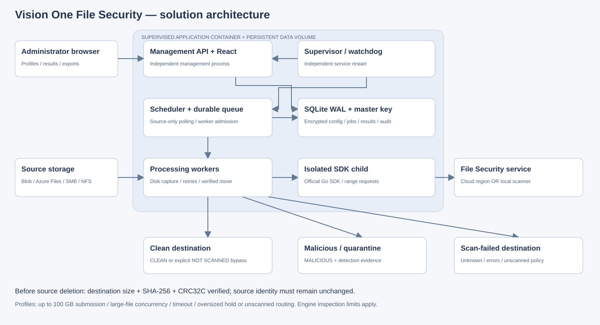

# File Security Scanner — customer PoC architecture

This document describes the implementation in this repository and can be copied into a customer PoC document. The application integrates the official Trend Vision One File Security Go SDK; it is a custom storage orchestration console, not a vendor-certified appliance. Version scope: 20 October 2026.

Download the diagram as [SVG](images/solution-architecture.svg) or [PNG](images/solution-architecture.png) for presentations. The Markdown diagrams below remain editable.

## Components and responsibilities

| Component | Purpose and deployment |
|---|---|
| Administrator browser | Connect storage, configure scanner/profiles, inspect queue/results, export CSV/audit evidence, use sizing calculator. |
| Management API and React console | Independent process inside the application container; authenticated administration and paginated history. |
| Supervisor and watchdog | Starts management and engine independently; probes health, restarts failed children with bounded backoff. Docker restarts the container after exit. |
| Discovery scheduler | Polls only profile source/prefix; records inventory and unchanged-file observations before admission. |
| Durable queue and admission | SQLite jobs with immutable encrypted policy snapshots; global/profile worker limits and an independent profile cap for files at least 1 GB. |
| Processing workers | Capture source bytes to disk using bounded buffers; execute size policy, retries, SDK invocation, routing and verified deletion. |
| Optional archive extractor | Separate credential-free process; Landlock/seccomp, size/count/ratio/depth/time/process limits; fails closed. |
| SDK child process | One isolated process per scan; keeps endpoint settings separate between concurrent requests. The SDK serves file ranges requested by the service; the app does not truncate to 2 GiB. |
| File Security service | Cloud regional service or separately deployed local scanner. Inspection depth, format support, licensing and quotas belong to this service. |
| Storage connectors | Azure Blob, ADLS Gen2 via Blob HTTPS, Azure Files, SMB and NFSv3 TCP AUTH_SYS. Application connections, not privileged OS mounts. |
| Routing and integrity | Publishes original bytes with unique names and tags, verifies size/SHA-256/CRC32C, then removes only the captured unchanged source identity. |
| Persistent data volume | SQLite WAL database, master encryption key, results/audit, move/claim records and source captures. Back up database and key together. |
| Destinations | Distinct clean, malicious/quarantine and scan-failed containers or shares. Restrict quarantine and failed storage using storage permissions. |

## Deployment and trust boundaries

One supervised container exposes the console/API (current PoC port 8095). The data volume survives upgrades. The scanner service and source/destination storage are external. Multiple connections and profiles share worker, disk and network budgets.

Credentials and snapshots are encrypted with AES-256-GCM using the host master key; passwords use bcrypt. SDK credentials use private process input, not command-line arguments. Sessions use HttpOnly cookies. Configure HTTPS across untrusted networks. NFS AUTH_SYS is not Kerberos; use a trusted network.

~~~mermaid
flowchart TB
    Admin[Administrator browser] --> API
    subgraph Host[Application container on customer host]
        Supervisor[Supervisor and watchdog] --> API[Management API / React console]
        Supervisor --> Engine[Source discovery and processing engine]
        API <--> DB[(SQLite WAL: encrypted config / jobs / results / audit)]
        Engine <--> DB
        Engine --> Queue[Admission: global / profile / large-file limits]
        Queue --> Workers[Capture / scan / route / verify workers]
        Workers --> Extract[Optional isolated extractor: shared bomb limits, up to 20 layers]
        Extract --> SDK[Isolated official SDK scans: original and members]
        Workers --> SDK
        Workers <--> Disk[Persistent captures and disk reservations]
    end
    SDK --> Service[Vision One cloud region OR local scanner]
    Source[Source: Blob / ADLS / Azure Files / SMB / NFS] --> Engine
    Workers --> Clean[Clean destination]
    Workers --> Bad[Malicious / quarantine destination]
    Workers --> Failed[Scan-failed destination]
    Workers -. verified destination then conditional source removal .-> Source
    API --> Evidence[Dashboard / history / CSV / audit / sizing]
~~~

## File lifecycle

~~~mermaid
sequenceDiagram
    participant P as Producer
    participant S as Source storage
    participant E as Scheduler and workers
    participant Q as Durable queue
    participant V as File Security service
    participant D as Destination storage
    P->>S: Upload original file
    E->>S: List source and observe unchanged identity across polls
    E->>Q: Persist source-version job and profile snapshot
    E->>E: Admit by worker, large-file and disk budgets
    E->>S: Capture exact bytes and calculate SHA-256
    E->>V: SDK scan of original file; service requests ranges
    V-->>E: Result, detections and errors
    E->>Q: Persist response and verdict or retry state
    E->>D: Copy original bytes and apply result tags
    E->>D: Verify size, SHA-256 and CRC32C by readback
    E->>Q: Persist verified move evidence
    E->>S: Delete only unchanged captured source identity
    E->>Q: Persist final state and audit
~~~

Clean results route to clean storage; malware routes to quarantine. Unknown/incomplete results and exhausted scan retries route to scan-failed storage and remain held. Transfer/delete failures preserve source or claimed source and use bounded retries.

Exclusions and explicit oversized bypasses are **NOT SCANNED**. A clean destination does not certify an unscanned file as safe.

## Large files and policy

The app admits original files up to **100 GB decimal** by default, configurable downward. It does not split or truncate files before SDK submission. An SDK verdict does not prove that every byte/member of an arbitrarily large file was inspected: engine inspection, extraction and format limits apply. Optional profile-controlled ZIP/TAR/GZIP inspection supports up to 20 layers; see [archive inspection](archive-inspection.md).

In **Scan profiles → Edit profile → Large files & size policy**, configure:

| Setting | Default | Meaning |
|---|---|---|
| Maximum scan file size | 100 GB | Files up to and including threshold are eligible for SDK scanning. |
| Files above scan-size limit | Hold at source | Alternatively move unscanned to clean or scan-failed storage, using that destination/prefix. |
| Simultaneous large files | 1 | Cap for files at least 1 GB, within normal profile/global slots. Small queued files remain eligible. |
| Maximum job duration | 21,600 seconds | Six hours per attempt; allowed range 60 seconds–48 hours. Includes capture, scan, copy and verification. SDK timeout follows this limit. |
| Oversized move tags | Automatic | scanned=false, verdict=not_scanned, reason=oversized. Record verdict OVERSIZED_CLEAN or OVERSIZED, never CLEAN. |

A full local source capture is required; RAM does not hold the entire file. Blob upload uses two 8 MiB transfer buffers. Destination verification streams into hashes without a second full disk copy. Admission reserves capture capacity plus a 5 GiB disk reserve. Capacity shortages defer work without spending scan attempts. Engine-owned capture files are cleaned on restart; interrupted jobs retry from durable records.

Provision disk for concurrent captures plus history, logs, backups and free space. The sizing calculator conservatively allows extra copies. Multiple complete reads/transfers are required, beyond SDK processing. At 1 Gbps, carrying 100 GB once takes at least about 13.3 minutes before overhead. Set timeout and concurrency from measured throughput. Disable the optional SDK cache digest only after assessing its performance tradeoff; application integrity hashing remains mandatory.

## PoC demonstration and acceptance evidence

1. Configure four distinct storage locations and verify read/write/tag/delete permissions.
2. Configure cloud region or local scanner and test authentication.
3. Enable automatic monitoring; upload safe and EICAR files to source.
4. Confirm queue admission, recorded responses, tags, destinations and verified source removal.
5. Upload a representative file above 2 GiB; record SDK outcome, timing and any engine limits.
6. Use a smaller size limit on a separate test profile to test hold/unscanned routing without a 100 GB upload.
7. Test outages, source changes, insufficient disk and container restart; verify preservation and durable retries.
8. Export file activity, source inventory and audit. Record build/profile revision, scanner region/type, file sizes/hashes, timings, quotas and host resources.

## Practical limits

- Polling cannot detect files deleted before observation; stability cannot prove a paused upload will never resume.
- A watchdog is not high availability; host outages interrupt processing.
- Full 100 GB end-to-end throughput and customer-scale soak validation need representative storage/network/scanner conditions. Sparse-file admission tests do not prove throughput.
- The old app rejection and fixed ten-minute timeouts are removed; engine inspection limits remain applicable.
- Unknown never defaults to clean. Explicit bypass stays distinguishable from a successful scan.
- External notifications remain deferred. Archive inspection is optional and defaults to off; configured limits and sandbox availability determine coverage.
- Restrict quarantine/failed storage, preserve backups/key and avoid competing instances on the same source/data directory.

See [user guide](user-guide.md), [operations](operations.md), [reliability](reliability.md) and [architecture detail](architecture.md).

## Archive demonstration

Enable the option on a dedicated profile and follow [archive acceptance checks](archive-inspection.md#suggested-poc-checks). An original SDK error still prevents a clean result; this is not an automatic override for unsupported archives.

## Current processing and console controls

See [transfer performance](performance-tuning.md) for the independent scan and transfer pools, shared/per-profile limits and one-pass leased Blob integrity check. The overview shows both queue depths; file records expose stage durations. See [user guide](user-guide.md) for light/dark appearance, reversible history hiding and simplified sizing. Hidden records never suppress held-file assurance alerts.

ADLS Gen2 setup, protocol choices and result metadata are documented in the [ADLS integration guide](adls-gen2.md). Validate a real HNS account as part of the customer acceptance checklist.
