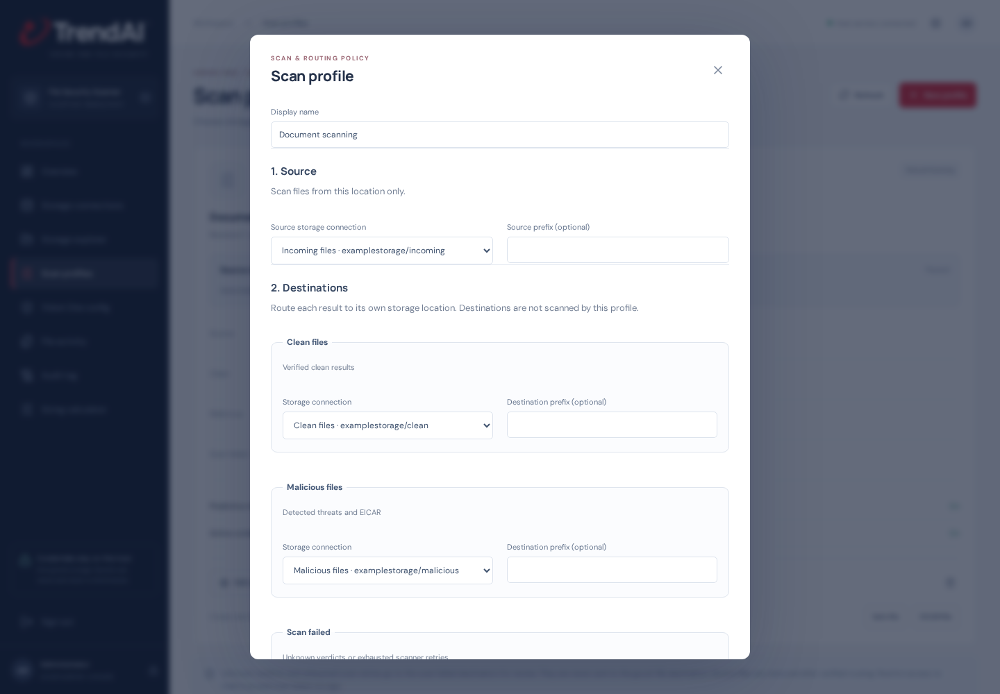

# How to use File Security Scanner

This guide takes you from an empty console to your first automatically scanned file. You do not need to write code. Ask your storage administrator for access details and your Trend administrator for a File Security API key.

**On this host, open [the console](http://192.168.1.52:8095).** To install the product on another host, follow [deployment instructions](operations.md#container-first-host-deployment).

Screenshots below show the real console with demonstration settings. `examplestorage` and the example containers are placeholders, not working storage. The example profile is paused so the screenshots do not trigger scans.

## Before you start

You need four separate storage locations. Create them in your storage system first; adding a connection in this console does not create a container or share.

| Purpose | Suggested name | What belongs here |
|---|---|---|
| Source | Incoming files | Files waiting to be scanned |
| Clean destination | Clean files | Files with a clean scan result, or an explicitly configured scan bypass |
| Malicious destination | Malicious files | Files containing a detected threat |
| Scan failed destination | Scan failed | Files the scanner could not confidently classify |

Use distinct locations that do not overlap. Keep malicious and scan-failed storage restricted to authorized staff. The tool reads from the source and removes a source file only after its destination copy passes verification. Keep backups according to your organization's policy.

## 1. Sign in

Open the console. On the first visit, create an administrator password with at least 12 characters and confirm it. On later visits, enter that password to sign in. Store it in your password manager.

The left menu takes you to each task. **Overview** shows current activity and setup progress.

## 2. Connect your four storage locations

Open **Storage connections → Add connection**. Give each connection a recognizable display name, such as **Incoming files**. Choose the connection type, fill in its access details, test access, then click **Save connection**. Repeat for clean, malicious and scan-failed storage.

### Which connection type should I choose?

| Storage type | Information to enter |
|---|---|
| Azure Blob Storage | Storage account name, container name, account key or SAS token |
| Azure Files | Storage account name, file share name, account key or SAS token |
| SMB share | Server hostname/IP, share name, username, password, optional domain; normally port 445 |
| NFS share | Server, export path, UID and GID permitted by the export; NFSv3 TCP AUTH_SYS is supported |

For Azure Blob, the **storage account** and **container** are different. In `https://examplestorage.blob.core.windows.net/incoming/report.pdf`, enter account `examplestorage` and container `incoming`. The Azure resource ID is optional when entering them directly.

If you do not know the container/share name, enter the account/server and credentials, click **List containers** or **List shares**, then choose a returned name. You can leave the container name blank while listing. Discovery requires appropriate account/server permissions; a known share may be accessible even when listing shares is blocked.

Use **Test container** or **Test share** to verify a particular location. Request and response panels help diagnose failures; credentials are redacted. Test/list actions read storage; saving a connection stores its credentials encrypted on this host.

Leave **Connection prefix** blank to use the whole container/share. Use a prefix only to restrict a connection to a folder, for example `incoming/`. A profile can narrow that source further. Blank prefixes are simplest for a first setup.

Source access needs listing, reading and deletion; share sources also need rename/directory permissions for handoff. Destination access needs writing and reading; Azure Blob tags and leases need the corresponding permissions. Ask your storage administrator if an access test or routing fails.

## 3. Connect Vision One File Security

Open **Vision One config**.

1. Choose **Cloud scanner** for the Vision One cloud service, or **Local scanner** for an existing self-hosted File Security service.
2. Enter your **Vision One API key**. For cloud scanning, choose the region belonging to that key. For local scanning, enter the service address, such as `scanner.internal:50051`, and choose the correct TLS setting.
3. Click **Save Vision One settings**.
4. Use the page's API-key/file diagnostic actions to verify access and inspect their request/response details.

The key needs File Security scanning permission. A saved configuration is not proof that a scan will succeed. When editing a saved endpoint, leave its key field blank to keep the stored key. Changing endpoints may require entering a key again.

Scanner diagnostics test connectivity/scanning directly. They do **not** prove that a profile's source-to-destination routing works. Use the profile test in step 5 for that.

## 4. Create a scan profile

Open **Scan profiles → New profile** (or **Create scan profile** when no profiles exist). A profile describes one workflow: where files arrive, how they are scanned and where results go.

1. Give it a display name, such as **Document scanning**.
2. Under **Source**, select **Incoming files**. Leave the source prefix blank unless you want only one folder scanned.
3. Under **Destinations**, choose **Clean files**, **Malicious files** and **Scan failed** in their corresponding sections. Leave destination prefixes blank to use each location's root.
4. Enable **automatic source scanning** and choose a frequency, such as **30 seconds**. The minimum is 10 seconds.
5. Set **Simultaneous scans** to the number of files this profile may process at once (default **2**). The shared engine has **8** slots by default, so a higher profile setting cannot exceed available capacity. Start conservatively and increase after checking scanner quotas and storage performance.
6. Keep the initial detection/retry settings unless your security administrator needs different behavior.
7. Click **Save profile**.

The three destinations each have their own selection:

Only the profile's source is monitored. Its destinations are not automatically scanned by that profile. Avoid overlapping sources across profiles so two workflows do not compete for the same inputs.

A profile slot stays occupied through download, scanning and routing. Lowering concurrency lets existing work finish before admitting more. Changes to concurrency apply to the existing queue, while each job keeps its captured scan/routing policy. The management console runs independently of the engine and shows whether it is running or recovering.

The frequency controls when the tool checks for files; it is not a promise to finish every scan in that time. A new file must stay unchanged across checks before admission. Uploads that are still changing wait; a paused upload can appear stable. Large batches also take time to discover and process.

### What do the other options do?

| Option | When/how to use it |
|---|---|
| Predictive machine learning | Enables the scanner's PML detection option. Follow your security policy. |
| Active content detection | Enables inspection for active content such as document scripting/macros. |
| SPN feedback | Enables the SDK's Smart Protection Network feedback option. Follow your organization's feedback/data-sharing policy. |
| Verbose scan results | Requests detailed engine results, useful when investigating detections or scan exceptions. |
| Digest calculation | Requests scanner-calculated file digests. Transfer integrity checks still use the application's own SHA-256/CRC32C verification. |
| Result tags | Enter comma-separated `key=value` pairs, such as `scanned=true,team=finance`. Common tags apply to clean/malicious results; result-specific tags add or override values. Blob uses tags; shares use a JSON sidecar. |
| Quiet period | How long a file must remain unchanged across observations before scanning. Keep the default for an initial test. |
| Retry limits | Maximum attempts, including the first, for scanning, copying and source deletion separately. The retry delay grows between failures. |
| Temporary-file ignore patterns | One pattern per line, for example `*.part`. Matching files stay at source and are not scanned. |
| Scanner-managed destination shares | Confirm this only when no other application writes to the share destinations. Reserve `.v1fs-claims` in share sources for the scanner account. |
| Exclusions/hold rules | Optional exceptions. Hold leaves matches at source. Bypass sends matches to clean storage as **NOT SCANNED** after integrity checks; it does not establish that they are safe. Use **Preview matches** before saving. |
| Failed-file recovery | Optionally retry isolated UNKNOWN jobs later. Set the wait in seconds (3,600 = one hour) and maximum recovery cycles. Exhausted files stay isolated for manual review. Detected malware is not automatically recovered. |
| Processing alert threshold | Raises a console alert for overdue work. It does not delete or discard files. |

For pattern examples, rule priority and recovery details, see [the profile reference](console.md#exclusions-and-hold-rules). You can leave rules and temporary ignore patterns empty to scan all ready source files.

## 5. Run your first end-to-end test

Open **Scan profiles** and find your profile.

1. Click **Safe file** under **Create test input**. This uploads a benign test file into that profile's source.
2. Wait for the source check, stability check and scan. If automatic scanning is off, click **Scan source**, select the test file in Storage explorer and submit it with the correct profile.
3. Open **File activity**. The safe test should finish as **CLEAN / COMPLETED**.
4. Check the clean destination in **Storage explorer**. Its new filename includes the original name and a job ID. The source copy should be gone after successful verification/deletion.
5. Return to the profile and click **EICAR file**. EICAR is an antivirus test pattern, not an executable malware sample. It should finish as **MALICIOUS / QUARANTINED** in malicious storage.

These profile buttons exercise the real storage, scheduler, scanner and routing path. The app copies original bytes; it does not wrap files in ZIPs or add archive passwords. Existing password-protected archives cannot be inspected without decryption by their owner and must not be treated as clean just because they could not be scanned.

## 6. Monitor files and investigate a result

In **Overview → Files scanned**:

- **Pending scans** shows files queued for scanning, including files waiting for a scan retry. It excludes held files and pending transfers with known verdicts.
- **Scanning now** shows jobs currently in the scanning stage, including source download and waiting for scanner access. It excludes queued files and destination transfers. Zero can simply mean the scanner is idle.
- **Past minute/hour/24 hours/30 days** are rolling totals for jobs with a scanner response. They are not queue counts. Open **How counts are calculated** for details.
- Set **Auto-refresh** to the update interval you want, or choose Off and use **Refresh**. The current count is a snapshot from the latest refresh. This setting is available on Overview, File activity and Audit log, and is remembered in your browser.

In **File activity**, the counter shows exactly how many records match, for example **Showing 1–100 of 1,000 files**. Use **First**, **Previous**, **Next**, **Last** or the **Page** selector above or below the table. To display a complete 1,000-file batch on one page, set **Rows per page → 1000**. Larger histories remain available across pages; there is no latest-500 history cutoff. Search by filename or select a verdict/state/date filter to search the full history, not only the visible rows. Changing a filter returns to page 1. Use **Clear filters** to restore the full list. Click a filename to inspect its result, malware names when recorded, destination, errors and integrity evidence. **Show scanner response** reveals recorded scanner details; older records may not have them.

| State/result | Meaning | What to do |
|---|---|---|
| QUEUED | Accepted and waiting for a worker | Wait; check backlog and processing alerts |
| SCANNING | Worker is downloading/scanning the input | Wait for the scanner response |
| ROUTING | Copying/verifying the destination or finalizing deletion | Wait; inspect errors if it stays here |
| CLEAN / COMPLETED | Clean scan and completed verified move | Use the file in clean storage |
| MALICIOUS / QUARANTINED | Threat detected and routed | Follow your security investigation process |
| UNKNOWN / HELD | Unclassified scan or work needing review | Read the error and verified destination; fix the cause, then use the appropriate retry/recovery action |
| EXCLUDED / NOT SCANNED | Bypass rule was applied | Review the rule; this is not evidence of a clean scan |
| RETRY_PENDING | A temporary problem is scheduled for another attempt | Check error and retry limits |

A held record may represent a transfer/delete problem rather than an unknown scan. Always read its error and integrity status. A verified destination may already exist while source deletion is still pending.

Use **Audit log** to see configuration changes and processing transitions. External notifications are not configured; check the console's alerts and unresolved records.

## 7. Export the file list

Click **Export CSV** on Overview or File activity to download the full job history, including filename, result, malware details when recorded, timestamps, hash presence/value, destination, attempts and errors. CSV export is not limited to the currently displayed page or its filter. Use **Export source inventory** on Overview to inspect observed source versions and accounting status. JSON export covers the currently loaded activity/audit records.

## If something does not work

| Symptom | First checks |
|---|---|
| No files are detected | Confirm automatic scanning is on, the source/prefix is correct and the last source check advances. Check storage access, stability and hold/ignore rules. |
| A file is taking longer than the scan frequency | Check queue size and processing alerts. Poll frequency is not a completion deadline. |
| List shares fails but Test share succeeds | Enumeration may be restricted. Enter the known share name directly and test it. |
| Clean files do not arrive | Open the record. Check the scan verdict and destination write/read/tag/lease permissions; do not assume every HELD file is malware. |
| File remains at source after copying | Check delete permissions and whether the source changed. The app retains it when safe deletion cannot be established. |
| UNKNOWN result | Inspect the scanner error: credentials/region, service availability, unsupported/encrypted input or scan limits. Fix the cause and retry/recover; never manually label it clean without a valid scan. |
| Page looks unchanged | Check Auto-refresh and Last refreshed; click Refresh. |

Ask an administrator to use the [operations guide](operations.md) for container health, backups, upgrades and rollback. Keep the database and encryption key together in backups; do not delete them to fix a sign-in or scan problem.

## Storage results and native tags

Storage explorer shows **Scan result** and **Result tags** for destination files. The earlier **Completion marker / Not set** column described upload metadata, not a scan verdict, and has been removed. For Azure Blob, these are actual native tags returned by Azure. Clean/malicious destinations automatically receive `scanned=true` and the corresponding `verdict` tag, even when custom tag fields are blank; reserved tags cannot contradict the scanner result. Additional tag permissions may be needed. If tag reads are denied, the file list still loads and reports that tags are unavailable.

Open **File details** to see the exact destination's linked scan record, malware names and recorded scanner response. Full responses stay encrypted in the application database; compact tags and metadata stay with the blob. A tag alone is not proof of a scan: the console links results only to an exact recorded destination. Unlinked files say NOT RECORDED. File shares retain their JSON result sidecars; native Azure tag columns do not imply that every share has native tags.

## Understanding processing warnings

**Active files exceeded the processing deadline** means work is still queued/scanning/routing beyond the profile's alert threshold. Check queue size, concurrency, scanner availability and storage errors. The threshold is an alert, not a deletion rule.

**Files held for review** is a separate condition. Click **Review held files**, open the record and read its error. Fix credentials, file identity or destination permissions before retrying. A file that was merely renamed or re-uploaded is not automatically assumed safe.

An old source-read failure can become **SUPERSEDED** only if a later successful scan covers the same recorded filename/profile/source and exact SHA-256, its destination bytes are freshly reverified, and the old source identity is absent or replaced. This resolves a historical duplicate warning without changing its original UNKNOWN verdict/error or deleting a file. Missing evidence, changed destination bytes, source access errors or an unchanged original still at source keep the record HELD. Audit log records the verified replacement job.

## Sizing for 12,000 files per day

Choose **Sizing calculator**, directly after Audit log. It starts with 12,000 files/day, an 8-hour processing window, 5 MiB average / 250 MiB maximum file size, a 4× arrival peak, one second per active file and 2× headroom. Under those assumptions, the application-host estimate is **4 vCPU, 4 GiB RAM, 110 GiB SSD and 4 simultaneous active files**. The disk estimate includes 90 days of 32 KiB/job history, WAL/growth allowance, temporary files and free-space reserve. It does not include remote destination storage or a separately hosted local scan engine.

Adjust the inputs to your real workload, especially measured time through download/scan/verified move, file sizes and retention. Open **Advanced disk and retention assumptions** and **Formulas and limits** to inspect the model. Calculator changes do not change profiles, delete history or configure hardware. Use the resulting concurrency as a starting point in **Scan profiles → Edit → Simultaneous scans** and ensure the shared engine worker cap is high enough. Profile settings above that cap do not create additional workers. Validate representative documents, large files/archives, retries and storage latency before treating this as a capacity commitment.

These are application planning estimates, not vendor-certified requirements. Cloud scanner compute is hosted by Trend; local scanner compute must be sized separately using the scanner's own guidance. [File Security overview](https://docs.trendmicro.com/en-us/documentation/article/trend-vision-one-what-is-file-security) · [Containerized scanner](https://docs.trendmicro.com/en-us/documentation/article/trend-vision-one-file-security-containerized-scanner).
