# How to use File Security Scanner

This guide takes you from an empty console to your first automatically scanned file. You do not need to write code. Ask your storage administrator for access details and your Trend administrator for a File Security API key.

**On this host, open [the console](http://scanner-host:8095).** To install the product on another host, follow [deployment instructions](operations.md#container-first-host-deployment).

Screenshots below show the real console with demonstration settings. `examplestorage` and the example containers are placeholders, not working storage. The example profile is paused so the screenshots do not trigger scans.

## Before you start

You need four separate storage locations. Create them in your storage system first; adding a connection in this console does not create a container or share.

| Purpose | Suggested name | What belongs here |
|---|---|---|
| Source | Incoming files | Files waiting to be scanned |
| Clean destination | Clean files | Files with a clean scan result, or an explicitly configured scan bypass |
| Malicious destination | Malicious files | Files containing a detected threat |
| Scan failed destination | Scan failed | Files the scanner could not confidently classify |

Use distinct locations that do not overlap. Keep malicious and scan-failed storage restricted to authorized staff. The tool reads from the source and removes a source file only after its destination copy passes verification. Keep backups according to your organization's policy.

## 1. Sign in

Open the console. On the first visit, create an administrator password with at least 12 characters and confirm it. On later visits, enter that password to sign in. Store it in your password manager.

The left menu takes you to each task. **Overview** shows current activity and setup progress.

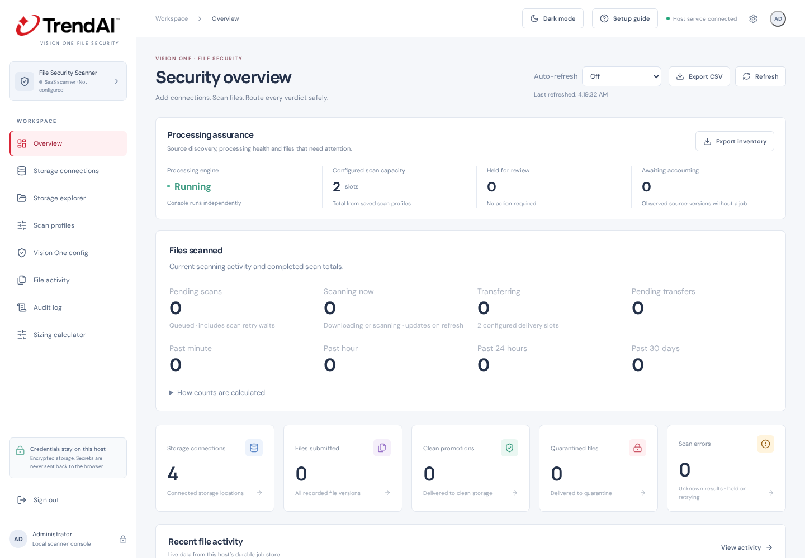

## 2. Connect your four storage locations

Open **Storage connections → Add connection**. Give each connection a recognizable display name, such as **Incoming files**. Choose the connection type, fill in its access details, test access, then click **Save connection**. Repeat for clean, malicious and scan-failed storage.

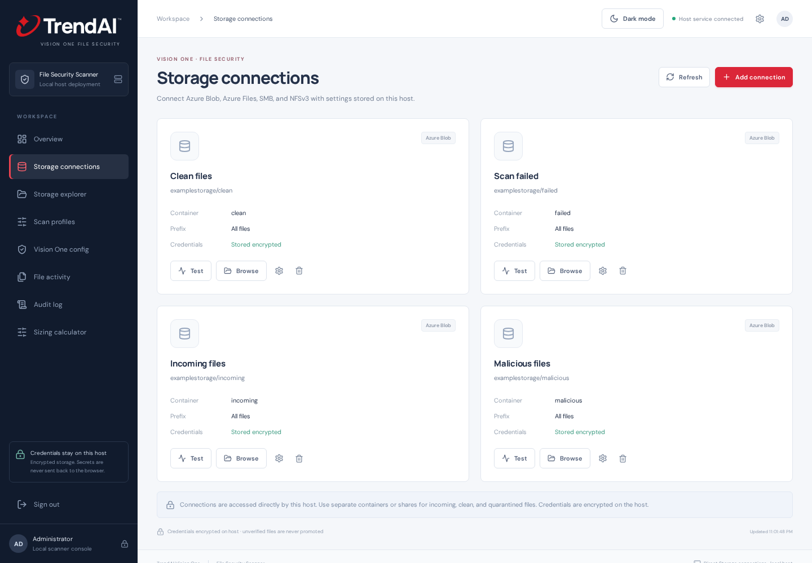

### Which connection type should I choose?

| Storage type | Information to enter |
|---|---|
| Azure Blob Storage | Storage account name, container name, account key or SAS token |
| Azure Files | Storage account name, file share name, account key or SAS token |
| SMB share | Server hostname/IP, share name, username, password, optional domain; normally port 445 |
| NFS share | Server, export path, UID and GID permitted by the export; NFSv3 TCP AUTH_SYS is supported |

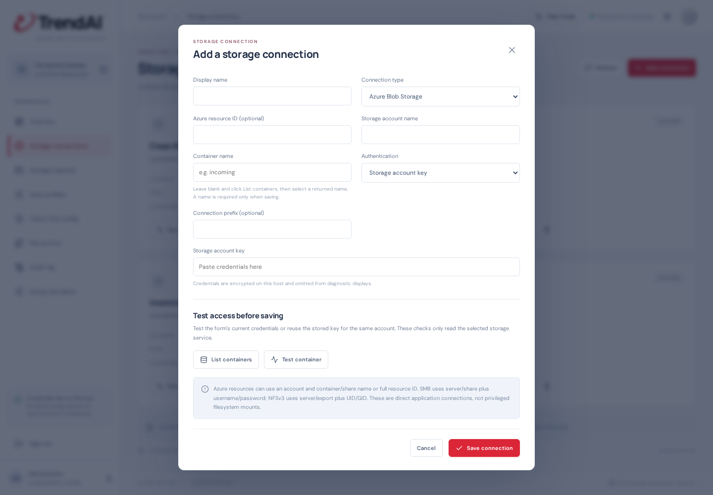

For Azure Blob, the **storage account** and **container** are different. In `https://examplestorage.blob.core.windows.net/incoming/report.pdf`, enter account `examplestorage` and container `incoming`. The Azure resource ID is optional when entering them directly.

If you do not know the container/share name, enter the account/server and credentials, click **List containers** or **List shares**, then choose a returned name. You can leave the container name blank while listing. Discovery requires appropriate account/server permissions; a known share may be accessible even when listing shares is blocked.

Use **Test container** or **Test share** to verify a particular location. Request and response panels help diagnose failures; credentials are redacted. Test/list actions read storage; saving a connection stores its credentials encrypted on this host.

Leave **Connection prefix** blank to use the whole container/share. Use a prefix only to restrict a connection to a folder, for example `incoming/`. A profile can narrow that source further. Blank prefixes are simplest for a first setup.

Source access needs listing, reading and deletion; share sources also need rename/directory permissions for handoff. Destination access needs writing and reading; Azure Blob tags and leases need the corresponding permissions. Ask your storage administrator if an access test or routing fails.

## 3. Connect Vision One File Security

Open **Vision One config**.

1. Choose **Cloud scanner** for the Vision One cloud service, or **Local scanner** for an existing self-hosted File Security service.
2. Enter your **Vision One API key**. For cloud scanning, choose the region belonging to that key. For local scanning, enter the service address, such as `scanner.internal:50051`, and choose the correct TLS setting.
3. Click **Save Vision One settings**.
4. Use the page's API-key/file diagnostic actions to verify access and inspect their request/response details.

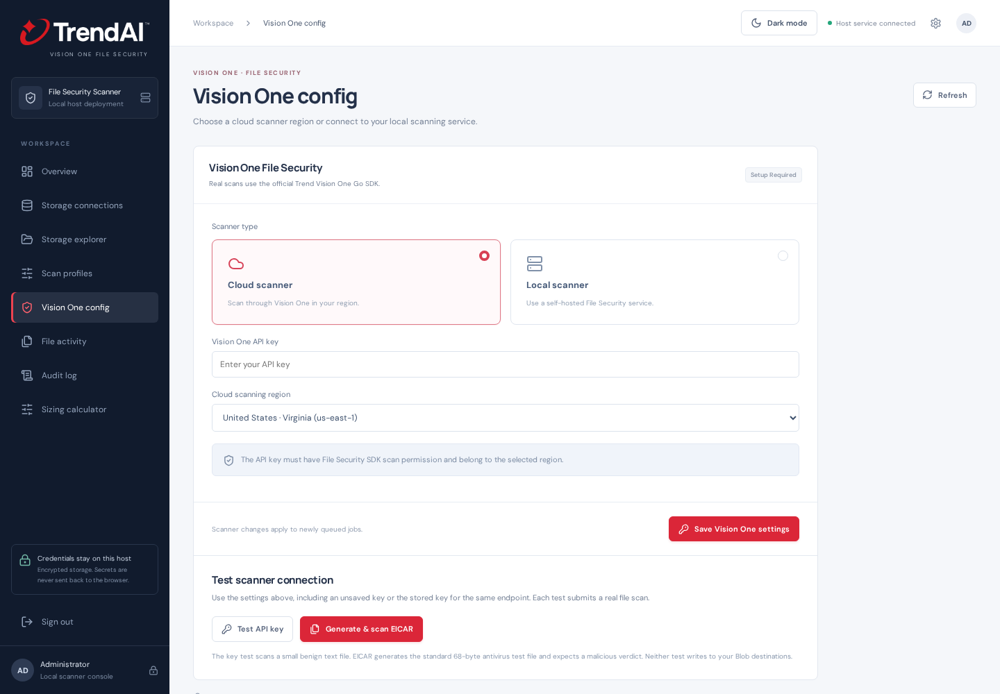

The key needs File Security scanning permission. A saved configuration is not proof that a scan will succeed. When editing a saved endpoint, leave its key field blank to keep the stored key. Changing endpoints may require entering a key again.

Scanner diagnostics test connectivity/scanning directly. They do **not** prove that a profile's source-to-destination routing works. Use the profile test in step 5 for that.

## 4. Create a scan profile in six steps

Open **Scan profiles → New profile**. Use **Next** to continue, **Back** to return, or the numbered step buttons to jump between sections. Your choices stay in place as you move. Nothing is saved until **Review → Save profile**. Missing or out-of-range fields are highlighted on their step before saving.

### Step 1 — Source

Give the profile a name such as **Document scanning**. Select **Incoming files** as its source. Leave the source folder/prefix blank to include every file, or enter a prefix such as `invoices/`. Subfolders are included.

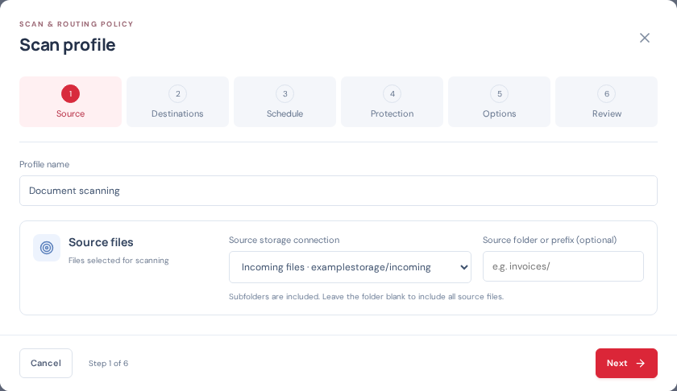

### Step 2 — Destinations

Choose one storage connection for each result: **Clean files**, **Malicious files** and **Scan failed**. Leave the subfolder blank to use that connection's root. Only the source is monitored. A source file is removed after its destination copy passes integrity verification.

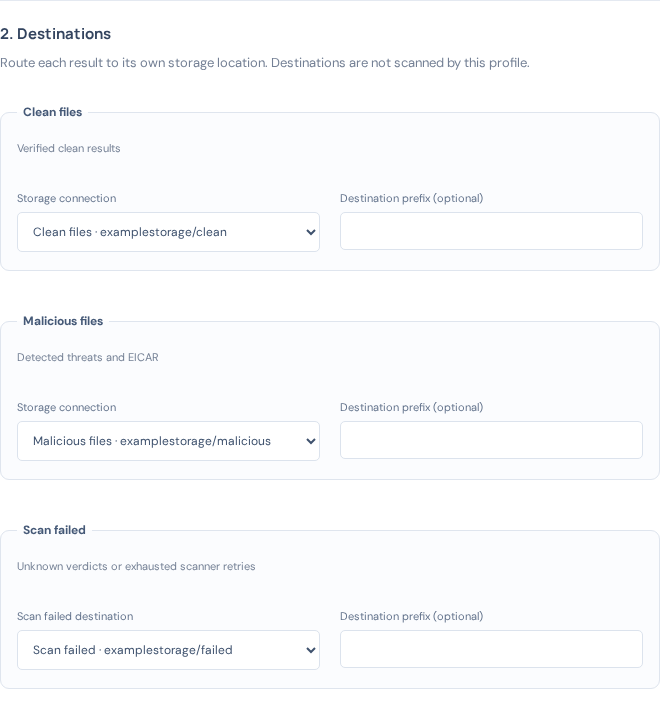

### Step 3 — Schedule

Turn on **Scan new files automatically** to watch the source. Set **Check for new files every (seconds)** to a polling interval, for example **30**. Set **Files scanned at once** to the concurrency you want; **2** is the starting value. Leave automatic scanning off to start scans from Storage explorer yourself.

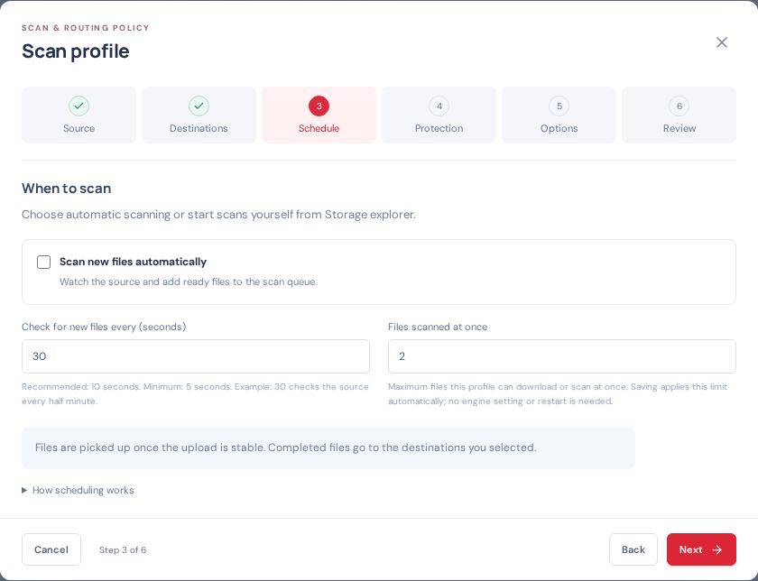

The tool checks that uploads have settled before admitting them. **How scheduling works** contains the technical details. Scan workers download and scan; transfer workers deliver and verify files separately.

### Step 4 — Protection

Choose **Detect suspicious files** and **Detect active content** according to your security policy. Open **Scan report preferences** for detailed responses, scanner file hashes and SPN feedback.

For archives, enable **archive extraction and member scans**. Open **Archive settings** to adjust nesting, count, size, ratio and time budgets. See [archive inspection](archive-inspection.md) for format and protection details.

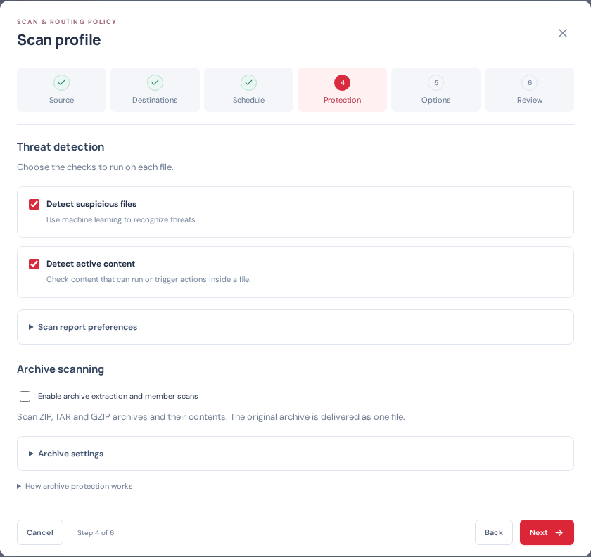

### Step 5 — Options

The defaults are ready to use. Open only the setting you want to customize:

| Section | What it controls |
| --- | --- |
| Result tags | Extra `key=value` labels, such as `team=finance`. Scan status and verdict tags are automatic. |
| Large-file handling | Scan size, large-file concurrency, timeout and the action for bigger files. Bypassed files are explicitly **NOT SCANNED**. |
| Transfer speed | How many files are delivered together and Azure Blob upload tuning. |
| Upload checks and retries | Quiet period, separate scan/copy/delete attempts, retry delay, temporary-file patterns and share ownership. |
| Exclusions and hold rules | Optional path/size exceptions. Hold leaves files at source. Bypass routes them to clean storage as **NOT SCANNED** after integrity verification. Use Preview matches first. |
| Failed-file recovery | Scheduled rescans of isolated unknown files, with a wait and recovery budget. |

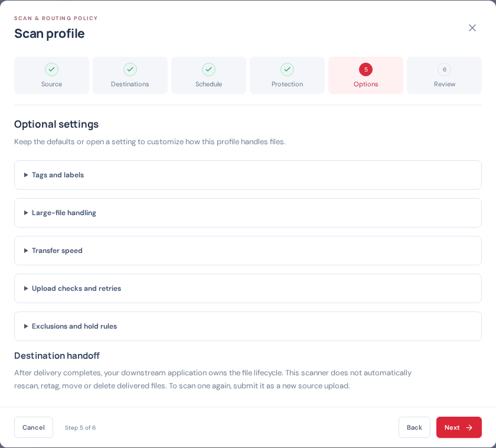

### Step 6 — Review and save

Check the source, all three destinations, schedule, protection and file-handling actions. Use an **Edit** link to revisit a section. Click **Save profile** when ready. The wizard closes and the profile appears in the list.

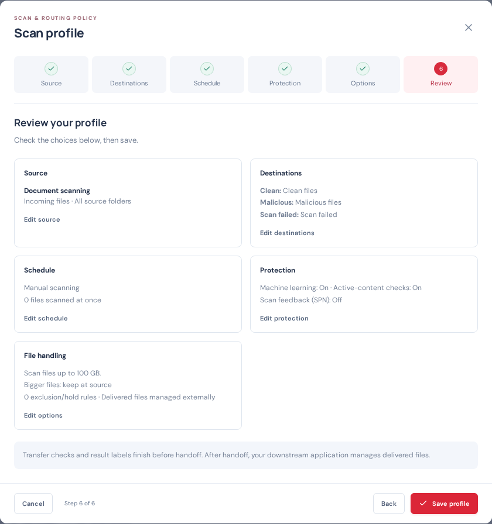

### Compact and expanded profile views

Cards initially show the name, schedule, concurrency and source, with **Edit profile** and **Scan source** always visible. Click **View details** to expand source monitoring, destinations, detection settings and test-file controls. Click it again to collapse.

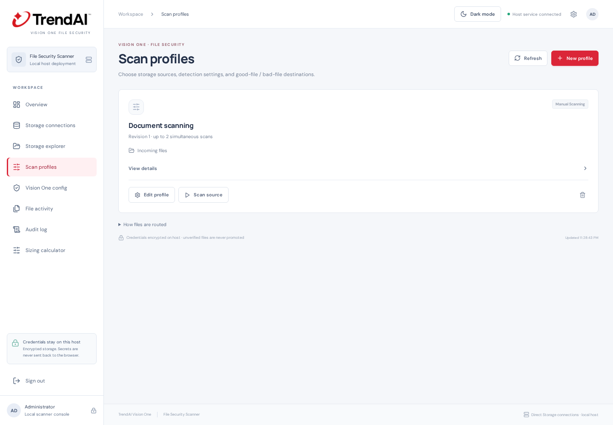

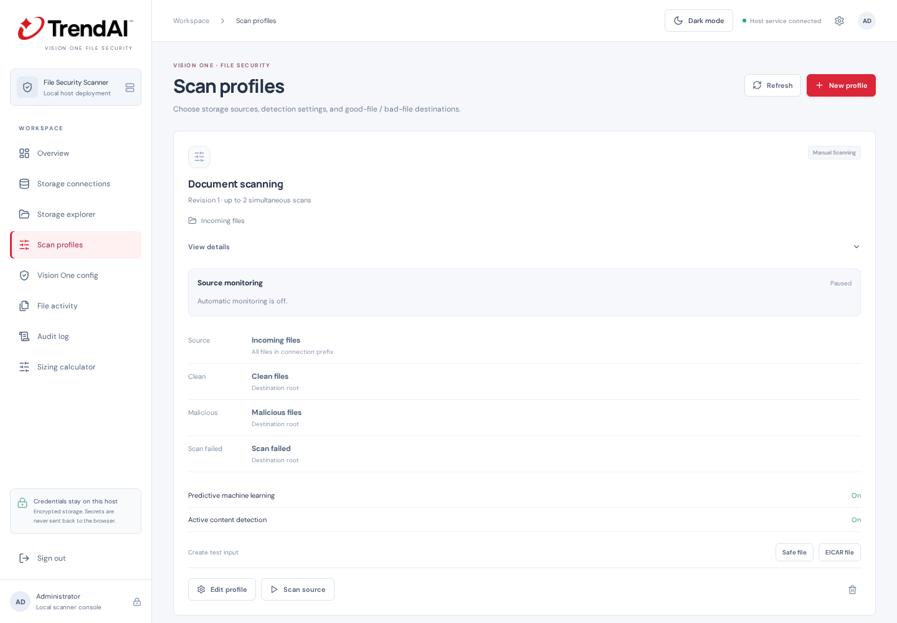

Each job keeps its captured routing/detection policy. Live scan admission uses the profile's current scan concurrency. Transfers use their own bounded pool and captured limits. See [performance controls](performance-tuning.md) for tuning and restart behavior.

## 5. Run your first end-to-end test

Open **Scan profiles**, find your profile and click **View details** to reveal its test-file buttons.

1. Click **Safe file** under **Create test input**. This uploads a benign test file into that profile's source.
2. Wait for the source check, stability check and scan. If automatic scanning is off, click **Scan source**, select the test file in Storage explorer and submit it with the correct profile.
3. Open **File activity**. The safe test should finish as **CLEAN / COMPLETED**.
4. Check the clean destination in **Storage explorer**. Its new filename includes the original name and a job ID. The source copy should be gone after successful verification/deletion.
5. Return to the profile and click **EICAR file**. EICAR is an antivirus test pattern, not an executable malware sample. It should finish as **MALICIOUS / QUARANTINED** in malicious storage.

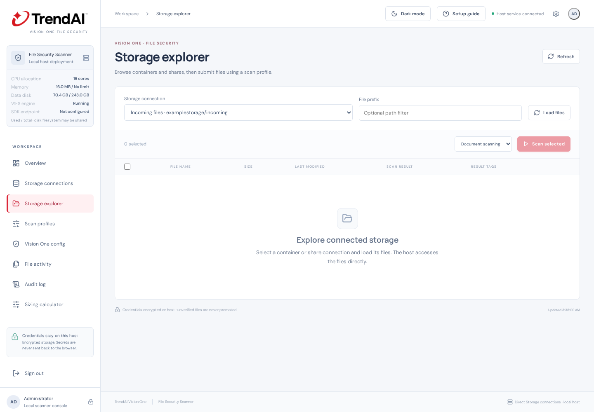

These profile buttons exercise the real storage, scheduler, scanner and routing path. The app copies original bytes; it does not wrap files in ZIPs or add archive passwords. Existing password-protected archives cannot be inspected without decryption by their owner and must not be treated as clean just because they could not be scanned.

## 6. Monitor files and investigate a result

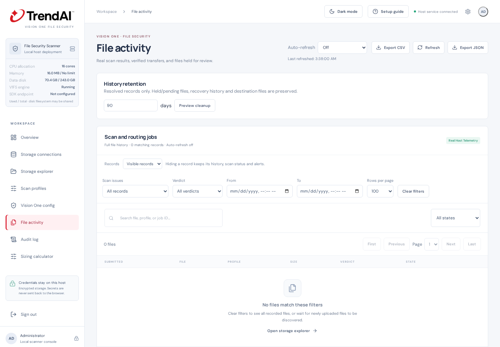

In **Overview → Files scanned**:

- **Pending scans** shows files queued for scanning, including files waiting for a scan retry. It excludes held files and pending transfers with known verdicts.
- **Scanning now** shows jobs currently in the scanning stage, including source download and waiting for scanner access. It excludes queued files and destination transfers. Zero can simply mean the scanner is idle.
- **Transferring** shows files being delivered and verified; **Pending transfers** shows the waiting transfer queue.
- **Past minute/hour/24 hours/30 days** are rolling totals for jobs with a scanner response. They are not queue counts. Open **How counts are calculated** for details.
- Set **Auto-refresh** to the update interval you want, or choose Off and use **Refresh**. The current count is a snapshot from the latest refresh. This setting is available on Overview, File activity and Audit log, and is remembered in your browser.

In **File activity**, the counter shows exactly how many records match, for example **Showing 1–100 of 1,000 files**. Use **First**, **Previous**, **Next**, **Last** or the **Page** selector above or below the table. To display a complete 1,000-file batch on one page, set **Rows per page → 1000**. Larger histories remain available across pages; there is no latest-500 history cutoff. Search by filename or select a verdict/state/date filter to search the full history, not only the visible rows. Changing a filter returns to page 1. Use **Clear filters** to restore the full list. Click a filename to inspect its result, malware names when recorded, destination, errors and integrity evidence. **Show scanner response** reveals recorded scanner details; older records may not have them.

| State/result | Meaning | What to do |
|---|---|---|
| QUEUED | Accepted and waiting for a worker | Wait; check backlog and processing alerts |
| SCANNING | Worker is downloading/scanning the input | Wait for the scanner response |
| ROUTING | Copying/verifying the destination or finalizing deletion | Wait; inspect errors if it stays here |
| CLEAN / COMPLETED | Clean scan and completed verified move | Use the file in clean storage |
| MALICIOUS / QUARANTINED | Threat detected and routed | Follow your security investigation process |
| UNKNOWN / HELD | Unclassified scan or work needing review | Read the error and verified destination; fix the cause, then use the appropriate retry/recovery action |
| EXCLUDED / NOT SCANNED | Bypass rule was applied | Review the rule; this is not evidence of a clean scan |
| RETRY_PENDING | A temporary problem is scheduled for another attempt | Check error and retry limits |

A held record may represent a transfer/delete problem rather than an unknown scan. Always read its error and integrity status. A verified destination may already exist while source deletion is still pending.

Use **Audit log** to see configuration changes and processing transitions. External notifications are not configured; check the console's alerts and unresolved records.

## 7. Export the file list

Click **Export CSV** on Overview or File activity to download the full job history, including filename, result, malware details when recorded, timestamps, hash presence/value, destination, attempts and errors. CSV export is not limited to the currently displayed page or its filter. Use **Export source inventory** on Overview to inspect observed source versions and accounting status. JSON export covers the currently loaded activity/audit records.

## If something does not work

| Symptom | First checks |
|---|---|
| No files are detected | Confirm automatic scanning is on, the source/prefix is correct and the last source check advances. Check storage access, stability and hold/ignore rules. |
| A file is taking longer than the scan frequency | Check queue size and processing alerts. Poll frequency is not a completion deadline. |
| List shares fails but Test share succeeds | Enumeration may be restricted. Enter the known share name directly and test it. |
| Clean files do not arrive | Open the record. Check the scan verdict and destination write/read/tag/lease permissions; do not assume every HELD file is malware. |
| File remains at source after copying | Check delete permissions and whether the source changed. The app retains it when safe deletion cannot be established. |
| UNKNOWN result | Inspect the scanner error: credentials/region, service availability, unsupported/encrypted input or scan limits. Fix the cause and retry/recover; never manually label it clean without a valid scan. |
| Page looks unchanged | Check Auto-refresh and Last refreshed; click Refresh. |

Ask an administrator to use the [operations guide](operations.md) for container health, backups, upgrades and rollback. Keep the database and encryption key together in backups; do not delete them to fix a sign-in or scan problem.

## Storage results and native tags

Storage explorer shows **Scan result** and **Result tags** for destination files. The earlier **Completion marker / Not set** column described upload metadata, not a scan verdict, and has been removed. For Azure Blob, these are actual native tags returned by Azure. Clean/malicious destinations automatically receive `scanned=true` and the corresponding `verdict` tag, even when custom tag fields are blank; reserved tags cannot contradict the scanner result. Additional tag permissions may be needed. If tag reads are denied, the file list still loads and reports that tags are unavailable.

Open **File details** to see the exact destination's linked scan record, malware names and recorded scanner response. Full responses stay encrypted in the application database; compact tags and metadata stay with the blob. A tag alone is not proof of a scan: the console links results only to an exact recorded destination. Unlinked files say NOT RECORDED. File shares retain their JSON result sidecars; native Azure tag columns do not imply that every share has native tags.

## Understanding processing warnings

**Active files exceeded the processing deadline** means work is still queued/scanning/routing beyond the profile's alert threshold. Check queue size, concurrency, scanner availability and storage errors. The threshold is an alert, not a deletion rule.

**Files held for review** is a separate condition. Click **Review held files**, open the record and read its error. Fix credentials, file identity or destination permissions before retrying. A file that was merely renamed or re-uploaded is not automatically assumed safe.

An old source-read failure can become **SUPERSEDED** only if a later successful scan covers the same recorded filename/profile/source and exact SHA-256, its destination bytes are freshly reverified, and the old source identity is absent or replaced. This resolves a historical duplicate warning without changing its original UNKNOWN verdict/error or deleting a file. Missing evidence, changed destination bytes, source access errors or an unchanged original still at source keep the record HELD. Audit log records the verified replacement job.

## Sizing for 12,000 files per day

Choose **Sizing calculator**, directly after Audit log. It starts with 12,000 files/day, an 8-hour processing window, 5 MiB average / 100 GB maximum file size, a 4× arrival peak, one second per reference 5 MiB file and 2× headroom. Under those assumptions, the application-host estimate is **4 vCPU, 4 GiB RAM, 1040 GiB SSD and 4 simultaneous active files**. The disk estimate includes 90 days of 32 KiB/job history, WAL/growth allowance, temporary files and free-space reserve. It does not include remote destination storage or a separately hosted local scan engine.

**The calculator does not change profile settings.** GB means 1 billion bytes. Profiles now allow original-file submission up to 100 GB, subject to scanner inspection/format limits. Configure concurrency, timeout and oversized handling in the profile. The maximum size reserves temporary disk. Average size also scales projected processing time: reference seconds × max(1, average MiB ÷ reference MiB). This is an explicit linear planning assumption, not a vendor performance guarantee. CPU/RAM grow through concurrency; above 32 slots, additional hosts are required, so consult total CPU/RAM as well as per-host values. Replace the one-second example with measured download, scan, routing and verification time for representative files, especially large files.

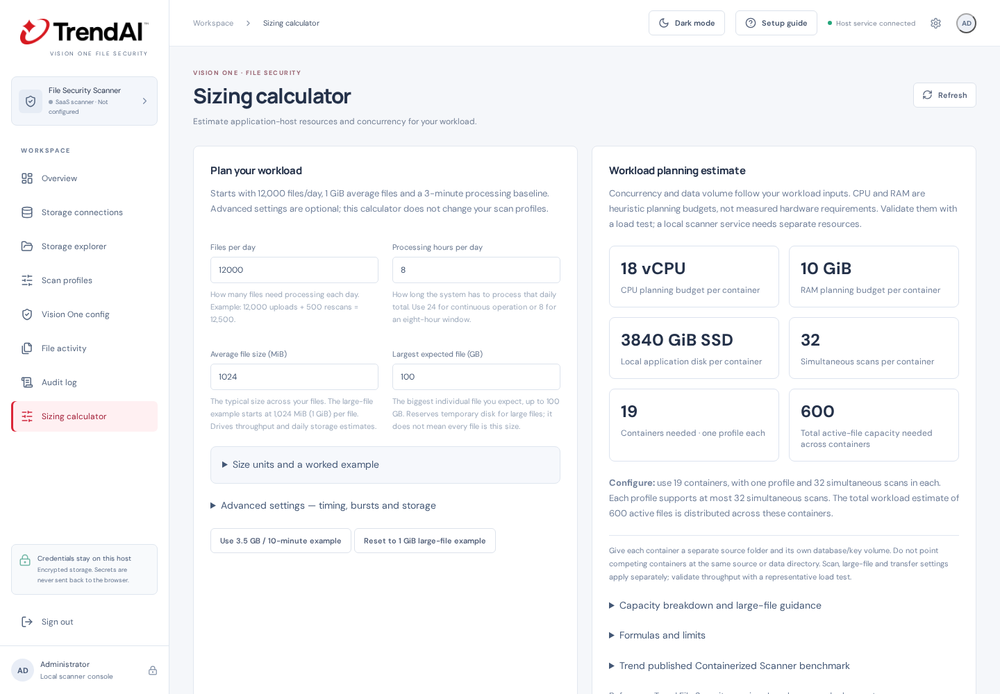

Adjust the inputs to your real workload, especially measured time through download/scan/verified move, file sizes and retention. Open **Advanced settings — timing, bursts and storage** and **Formulas and limits** to inspect the model. Calculator changes do not change profiles, delete history or configure hardware. Use the resulting concurrency as a starting point in **Scan profiles → Edit profile → Schedule → Files scanned at once** and ensure the shared engine worker cap is high enough. Profile settings above that cap do not create additional workers. Validate representative documents, large files/archives, retries and storage latency before treating this as a capacity commitment.

These are application planning estimates, not vendor-certified requirements. Cloud scanner compute is hosted by Trend; local scanner compute must be sized separately using the scanner's own guidance. [File Security overview](https://docs.trendmicro.com/en-us/documentation/article/trend-vision-one-what-is-file-security) · [Containerized scanner](https://docs.trendmicro.com/en-us/documentation/article/trend-vision-one-file-security-containerized-scanner).

### Vendor benchmark and calculator scope

[Trend’s Containerized Scanner performance guidance](https://docs.trendmicro.com/en-us/documentation/article/trend-vision-one-scaling-performance-cs), reviewed 20 October 2026, documents separate scanner-service benchmark allocations and tested file ranges. The console includes the reference figures; they do not establish 100 GB support. These scanner-service allocations are separate from this application host. The calculator’s CPU/RAM allowances and linear time projection are application planning assumptions, not Trend requirements. Replace reference time/size with representative measurements; test archive expansion, scanner quotas, transfer bandwidth and large-file limits separately.

## Configure large files

Open **Scan profiles → Edit profile → Options → Large-file handling**. Keep the default **100 GB maximum** to submit larger original files through the SDK. The app does not truncate at 2 GiB. Start with **Simultaneous large files = 1** and measure before increasing it. Set **Maximum job duration** to include capture, scan and verified routing (default six hours per attempt).

Above the threshold choose **Hold at source**, **Move to scan failed**, or **Move to clean — NOT SCANNED**. Both move options apply scanned=false, verdict=not_scanned and reason=oversized; neither generates a clean verdict. Use the scan-failed destination/prefix for an oversized review folder. Test actions with a small threshold on a dedicated profile. Moved files still require verified destination bytes before source removal.

An SDK verdict does not prove every byte/member was inspected. Scanner inspection/extraction limits remain applicable; optional application extraction is available per profile. See [customer PoC diagrams and limits](poc-architecture.md).

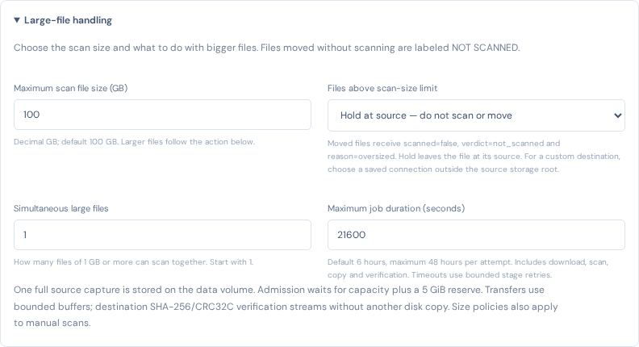

## Inspect compressed files

In **Scan profiles → Edit profile → Protection → Archive scanning**, enable extraction and member scans, then set a nesting limit from **1 to 20 layers**, file count, total/member expanded sizes, expansion ratio, extraction time and concurrency. Defaults are off / 5 layers / 1,000 entries / 10 GB total / 2 GB per member / 100× / 300 seconds / one inspection. Unsupported, encrypted, corrupt or over-budget archives never qualify as clean. The original and every extracted member must scan successfully before clean routing. [Step-by-step behavior, protections and testing](archive-inspection.md).

## Choose light or dark mode

Use **Dark mode / Light mode** in the upper-right header. On a narrow screen the button shows a moon or sun icon. The same toggle is on the sign-in page. Both the workspace and left menu follow this setting, including the logo. Your choice is saved in this browser and survives page changes, sign-out and reload. The first visit follows the operating system's appearance preference.

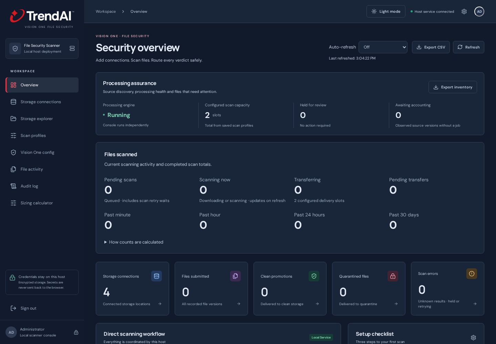

## Simplified sizing

Open **Sizing calculator** after Audit log. Enter files per day, processing hours, average size and largest expected file. Read the CPU, RAM, SSD and concurrency recommendation. Leave **Advanced settings** closed unless you have measured processing times or need to change burst/storage assumptions. **Capacity breakdown** and vendor benchmark details are expandable. These are planning estimates; validate against your storage and scanner.

## Hide a history record without deleting it

In **File activity**, use the crossed-eye **Hide record** button beside a file. Select **Records → Hidden records** or **All records** to find it again; click **Restore record** to restore it. Hidden records remain in CSV exports, audit history, statistics, source accounting and held-file alerts. Hiding never cancels a job or changes its verdict.

## Subfolders and validation files

Source discovery is recursive by default. Azure Blob lists every blob under the configured source prefix. Azure Files, SMB and NFS traverse subfolders under that prefix, with a 64-level limit and no symlink traversal. Only the profile source is monitored; destinations are not scanned by that profile. A prefix narrows discovery and is case sensitive.

A `runtimecheck/` destination folder can remain from the optional runtime validation utility. It holds earlier test results, is not a scanner component, and is not needed for normal operation. The utility runs only when explicitly invoked. Hide its historical records if desired; remove stored test files only after confirming they are no longer needed. The application's Hide record action does not delete storage objects.

See [transfer tuning](performance-tuning.md) for queue controls and file timing details.

Sizing fields include examples for daily file counts, processing windows, average versus maximum sizes, and storage allowances. Expand **Size units and a worked example** for MiB/GB conversions and the 12,000-file example. Advanced timing, peak-arrival and spare-capacity descriptions reflect the values you enter.

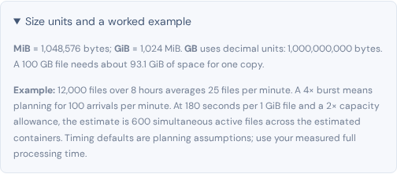

## Click an overview total to see its files

The **Files submitted**, **Clean promotions**, **Quarantined files** and **Scan errors** cards open File activity with a matching filter. The **Storage connections** card opens the connection list.

**Scan errors** counts unknown results that are currently held or waiting for retry. Resolved/recovered records and files intentionally held without scanning are excluded. The same filter is available under **File activity → Scan issues → Unknown results — held or retrying**. Clicking the card includes hidden records so its list matches the total. Hiding a row does not clear its error or its assurance alert. Use **Clear filters** to return to the full list.

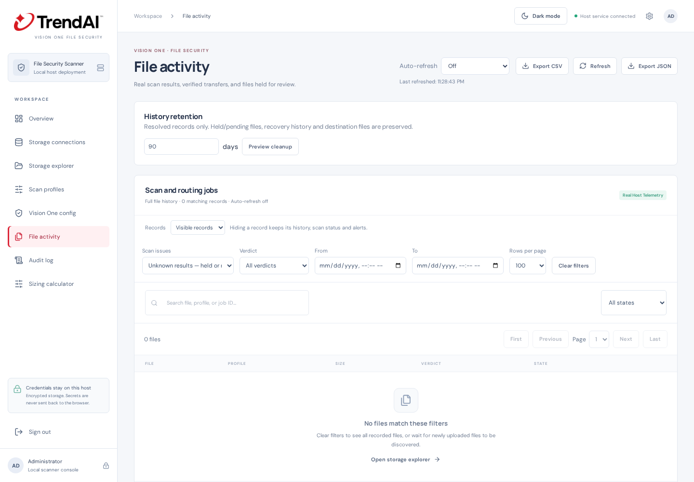

## Review configuration changes

Open **Audit log** to see saved configuration changes, processing decisions and operator actions. Use auto-refresh or Refresh for the latest entries, and Export JSON to keep a copy.

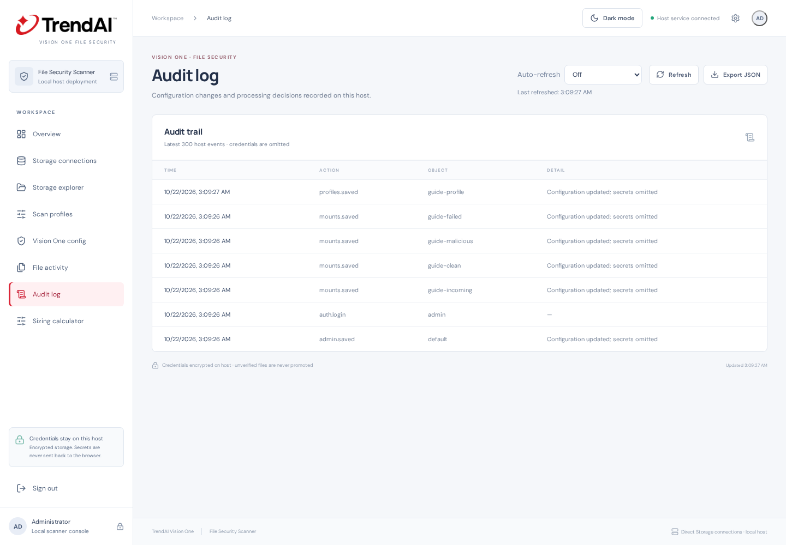

Archive settings: **Maximum archive entries** defaults to **10** and accepts **10–100**. The count is shared across all archive layers, including directories and nested archive members.

Result tags automatically include `scan-failed=true` and `scanned=false` for incomplete archive inspections or unknown scans routed after exhausted retries. Incomplete archives with detected malware retain their malicious verdict and quarantine routing. Complete clean/malicious scans receive `scan-failed=false`. Azure Blob stores native tags; shares store JSON sidecars. Existing destination objects are not retroactively retagged.

When scan, download or copy retries are exhausted, the record is held with `scan-failed=true` and `failure-stage`. The retained source receives these labels as native Blob tags or a share JSON sidecar, after a source-version check. Existing Blob tags are preserved. If storage access, tag capacity, or source identity prevents annotation, record details explicitly report that the source tag could not be written. A copy failure does not erase a confirmed scan verdict or remove the source.

Failed-file recovery reaffirms `scan-failed=true` when the result remains unknown. The file remains in its isolated Scan failed storage location, including a scanner-managed claim on shares, instead of being copied back into the input or promoted to Safe files. Exhausting recovery cycles leaves it held for manual review.

## Stop scanning a held file

In **File activity**, choose **HELD** and click **Acknowledge — stop scanning** next to the file. Confirm the message. The state becomes **ACKNOWLEDGED** and automatic retries/recovery stop for this exact upload version. Its unknown/failure verdict, file, tags, error evidence and audit history remain. It is not promoted to Safe files. A new upload version is processed normally. Acknowledged records remain available through **All states** or **ACKNOWLEDGED**. Hiding a record is separate and does not stop processing. If recovery is running, wait for it to finish before acknowledging.

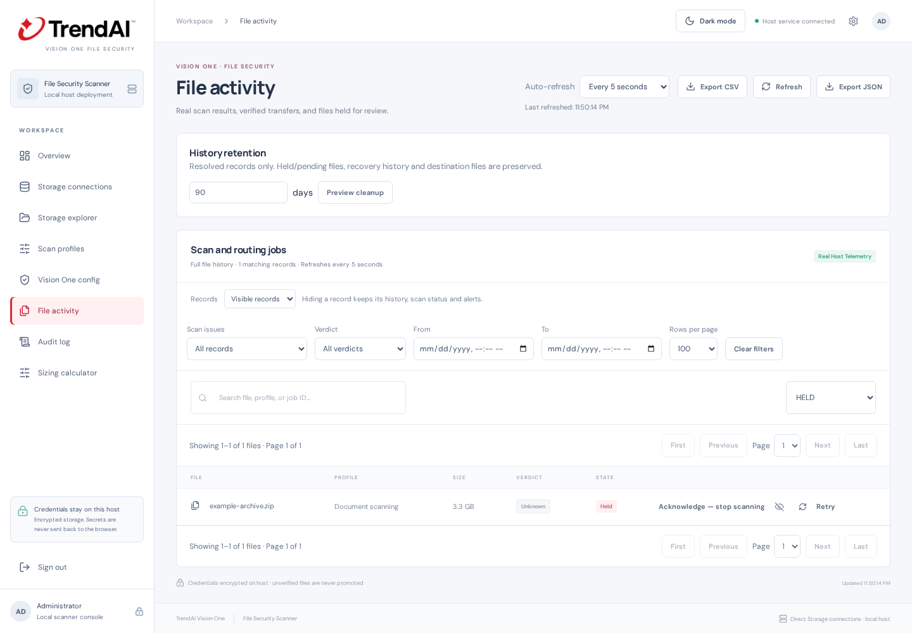

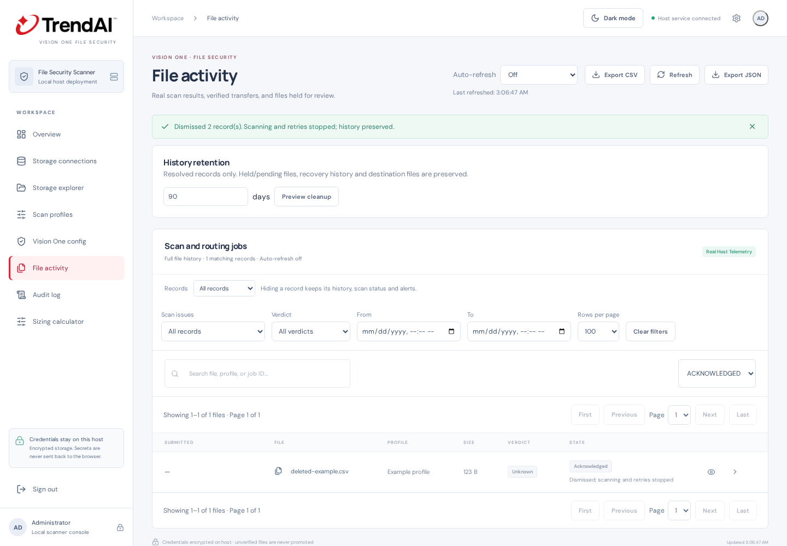

**Record details:** Show scanner response opens a separate response panel; Hide scanner response closes it. Technical record (JSON) is collapsed separately. Refresh detection details reloads the saved record and an open response without starting a new scan or closing the drawer. Success and error messages appear inside the drawer.

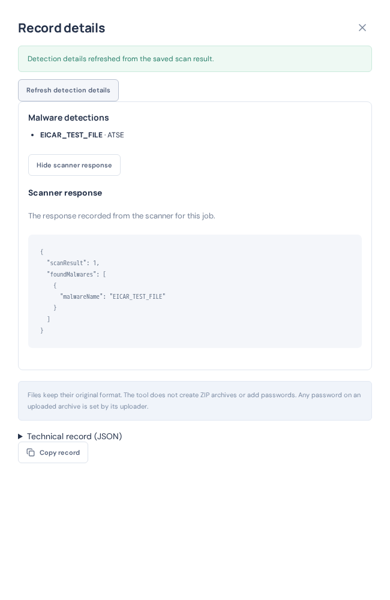

## Change the administrator password

Click **AD** in the top-right corner, enter the current password, choose a new password of 12–72 characters and repeat it in Confirm new password. Click **Change password**. The current browser receives a fresh session; other sessions are signed out. The storage credentials, scan configuration and file history stay intact. This tool currently has one administrator account.

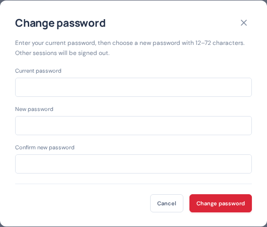

Archive retries show `reused: true` for successful member evidence reused within the same job. Reuse requires the same member name and SHA-256; failed/changed members are scanned again. Busy archive inspections wait for admission without occupying every general scan worker.

The first **Submitted** column in File activity and recent dashboard activity shows the job creation timestamp in your browser’s local timezone, including the timezone label. Hover for the original UTC timestamp. This distinguishes uploads sharing a filename; retries retain their original submission time.

### Optional destination content verification

In **Scan profiles → Edit profile → Options → Transfer speed**, use **Verify destination file contents before removing the source**.

- **On (default):** read back the delivered file and compare its size, SHA-256 and CRC32C before removing the source.
- **Off:** skip the full destination readback. Upload completion, size, destination identity, result tags and source identity checks remain required. This saves a full destination download but does not independently prove identical contents.

This applies to Azure Blob and share destinations. Scanning is unchanged. Existing profiles remain enabled, and queued jobs retain the setting captured when submitted. Record details show the selected verification mode; a skipped readback is never recorded as a successful content verification. Share handoff checks and small tag-sidecar verification remain enabled.

### ADLS Gen2 storage

Select **Azure Data Lake Storage Gen2 (HTTPS)** when adding a storage connection. Enter your account, filesystem as the container name, and account key or SAS. The connection can be used as a source or result destination. See [ADLS Gen2 setup and protocol choices](adls-gen2.md) for HTTPS, NFS, DFS and SFTP details, result metadata and the PoC acceptance checklist.

### Configure actual scan concurrency

Open **Scan profiles → Edit profile → Schedule → Files scanned at once** and save. This is the actual maximum for that profile (1–32). Setting it to **20** allows up to **20** files in download/scanning together. There is no separate eight-worker engine limit. Each profile has its own budget, and the engine grows its worker pool automatically from the saved settings, including manual-only profiles.

Changes apply live. Raising the value releases eligible queued work within about one second. Lowering it lets current scans finish and waits before admitting more. Overview's **Configured scan capacity** shows the total from saved profiles; **Scanning now** shows current activity. Large-file, archive, disk-capacity and transfer controls still apply to their respective stages.

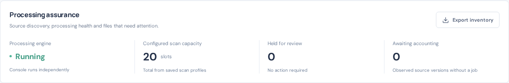
