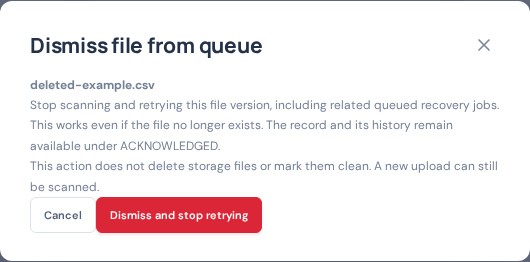

# Held and missing-file dismissal — 2026-10-21

The review shortcut previously inherited visibility filters, which could hide held records while assurance still counted them. Dismissal also blocked on queued recovery children and relied on a native browser confirmation. The updated review opens all held records, the in-app confirmation works in embedded browsers, and the queue action dismisses held/queued/retry-pending records across the related recovery family atomically. Active scans and transfers remain protected. No storage access is required and records are retained as ACKNOWLEDGED.

Validation:

- Full Go race suite passed (localapp 81.960 seconds), including missing hidden files, repeat dismissal, unchanged verdict/history, exact-version rescan prevention and active/queued recovery handling.
- Frontend production build and Go vet passed.
- All 20 desktop/mobile browser tests passed (1.3 minutes), including visible errors, cancel without mutation, no native confirmation, hidden held review and held-count updates.
- Production was idle at deployment and the application health check passed afterward. Existing records were left for the operator to review and dismiss explicitly.

