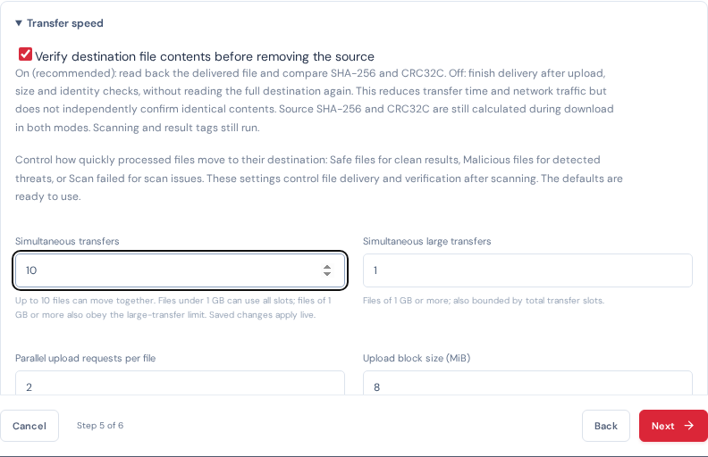

# Ten delivery slots and checksum audit — 2026-10-21

The transfer limit accepts 1–10 per profile and sizes the transfer worker pool live. Waiting jobs use current profile admission limits; their captured scan/integrity/upload policy remains unchanged. Files below 1,000,000,000 bytes can use all ten slots. Files at or above that threshold also obey the separate 1–2 large-transfer limit. The former environment pool ceiling is removed.

The earlier production sample had 32 configured scan workers but only one SCANNING job, 48 delivery jobs (two active), and no durable queued scans. This did not demonstrate 32 customer files actively scanning at once. Source discovery/admission and delivery are separate pipeline stages; discovered inventory is not equivalent to ready scan jobs. An isolated engine barrier test subsequently confirmed 32 scan calls can overlap without a scheduler serialization bottleneck. This is not a cloud scanner throughput benchmark.

CRC32C uses Castagnoli and is generated with SHA-256 during source download. Turning destination verification off skips the destination body readback, not source checksums. The destination checks timer still includes properties/size/identity checks. Record details now label source CRC32C and expose sourceChecksumAlgorithms. A test rejects any destination GET in the readback-off path and confirms one properties request with no content-verification timestamp.

Validation: full Go race suite passed (localapp 83.194 seconds), including ten admissions/rejection of the eleventh, live changes for already-queued transfers, the exact 1 GB boundary, continued small-file admission while the large limit is full, dynamic ten-worker startup, and 32 overlapping scan calls. All 20 desktop/mobile browser checks passed (1.4 minutes), including profile save at ten and engine reporting ten delivery slots. Production changes are applied only after active file delivery finishes.

